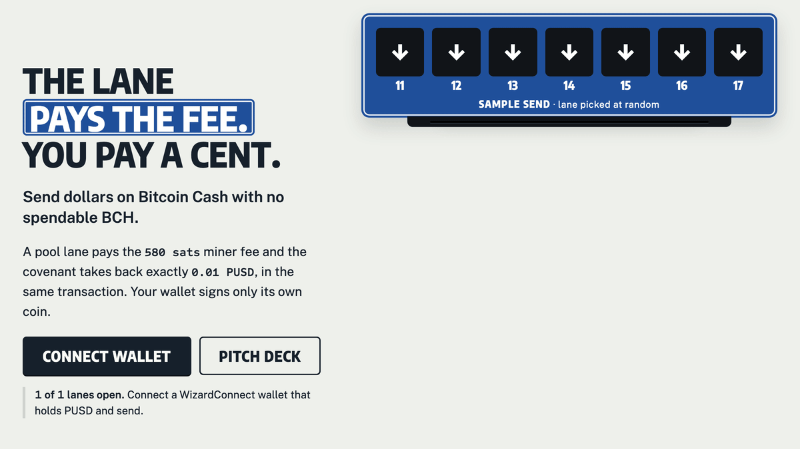
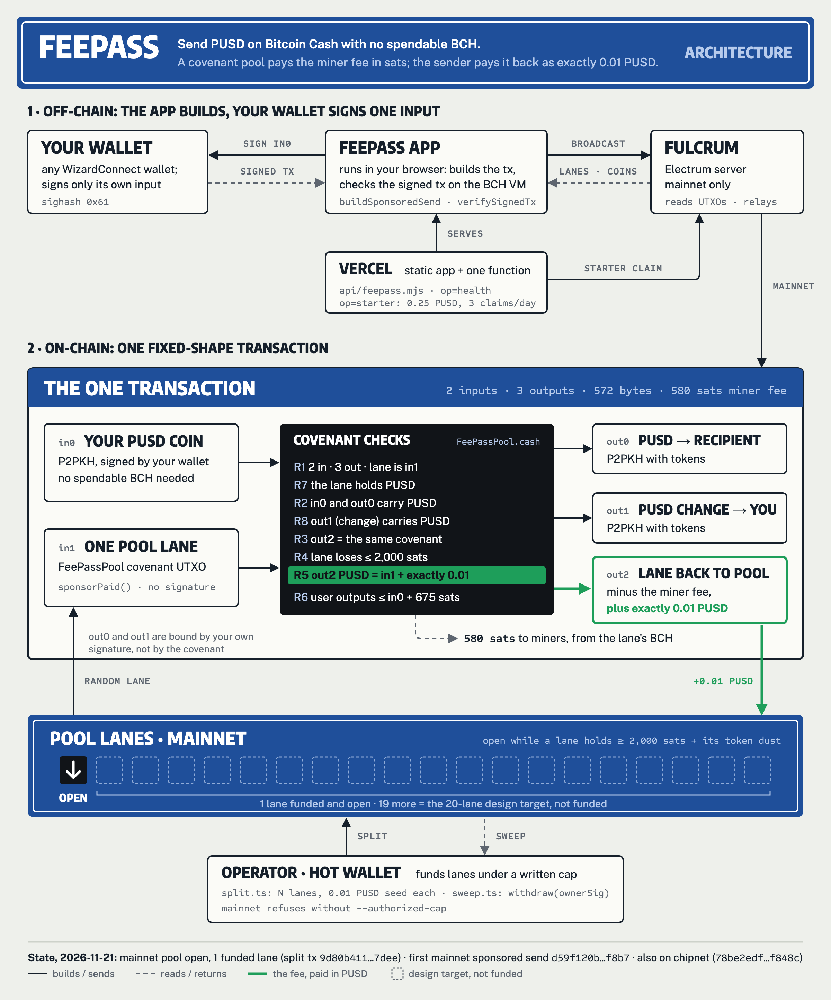

<div align="center">
  
  <h1>FeePass 🎫</h1>
  <p><em>For anyone holding PUSD but no spendable BCH: a covenant pays the Bitcoin Cash network fee, and you pay it back in PUSD in the same transaction.</em></p>
  

  <br/>

  [](https://feepass.edycu.dev)
  [](https://feepass.edycu.dev/judge/)
  [](https://youtu.be/-S5u7nPyUrQ)
  [](https://feepass.edycu.dev/deck/)
  [](https://dorahacks.io/hackathon/bchblaze2026/detail)

  <br/>

  
  
  
  
  [](LICENSE)
  [](https://github.com/edycutjong/feepass/actions/workflows/ci.yml)
  [](https://github.com/edycutjong/feepass/actions/workflows/codeql.yml)
  [](https://github.com/edycutjong/feepass/releases/latest)

</div>

---

> **Status: live on Bitcoin Cash mainnet.** First sponsored send: [`d59f120b…f8b7`](https://bchexplorer.info/tx/d59f120b5852280d98d6a84379c08e5b3cc11015a9c0f637e60577884aa6f8b7): 0.10 PUSD sent, the lane paid the 580-sat miner fee, the sender's spendable BCH stayed 0 → 0. One lane is funded (20 is the target); details, every txid, and the limits are under Live Deployment and on the [judge page](https://feepass.edycu.dev/judge/).

## 📸 See it in Action

<p align="center">
  
</p>

Captured frame by frame from the live front page. The booth is the site's own sample replay (its ticket says SAMPLE, not a mainnet send); "lane 14" is an example label. Live: <https://feepass.edycu.dev> (the pool page is `/pool`).

## 💡 The Problem & Solution

### The Problem

A new user holds dollars (PUSD, a CashToken on Bitcoin Cash) and **no spendable BCH**. Every transaction needs a miner fee paid in BCH, and sending part of a PUSD coin needs two token outputs of about 650 sats of dust each, so their wallet may not let them send those dollars on. Getting BCH first means an exchange detour: an extra step before a new user can move any of them.

### The Solution

A CashScript covenant, **the pool**, is designed to hold BCH in 20 UTXOs called lanes (the target; 1 is funded on mainnet today). A send spends the user's PUSD coin **and one lane** in the same transaction. The lane pays the miner fee. The covenant requires that exactly **0.01 PUSD** comes back to the pool, so the user pays the fee in dollars and the pool earns that revenue in PUSD. The user's wallet signs only its own input, over WizardConnect.

What it does and does not promise:

- **No spendable BCH needed.** The wallet's non-token BCH balance does not have to move. (It is not "zero BCH": a token coin always carries a few hundred sats of dust.)
- **The fee is paid in dollars.** It is not free and not gasless: 0.01 PUSD per send.
- **The covenant does not pick the recipient.** The user's own `SIGHASH_ALL|FORKID|UTXOS` (0x61) signature binds the outputs, and only as far as the wallet shows them. See [What the covenant does not check](docs/ARCHITECTURE.md#what-the-covenant-does-not-check).

## 🏗️ Architecture & Tech Stack

<p align="center">
  <a href="docs/architecture.html"></a>
</p>

| Layer | Choice | Where |
|---|---|---|
| Covenant | CashScript 0.14, 160-byte redeem script, 8 rules | [`contracts/FeePassPool.cash`](contracts/FeePassPool.cash) |
| Transaction builder | fixed shape, fee from the serialized size | [`src/core/sponsoredSend.ts`](src/core/sponsoredSend.ts) |
| Wallet link | WizardConnect (`@wizardconnect/dapp`, Vue adapter) | [`src/core/wizard.ts`](src/core/wizard.ts) |
| Chain access | Fulcrum over Electrum, **mainnet only** | [`src/core/config.ts`](src/core/config.ts) |
| App | Vue 3 + Vite + TypeScript, static | [`src/ui/`](src/ui/) |
| Starter PUSD | one serverless route (Vercel) | [`src/server/`](src/server/), [`api/feepass.mjs`](api/feepass.mjs) |

The covenant's eight rules, what each prevents, and the failure model are in [docs/ARCHITECTURE.md](docs/ARCHITECTURE.md). Every claim there names the file that proves it.

### Security properties

| | Property | Enforced by |
|---|---|---|
| F1 | The sender pays the fee in dollars: exactly 0.01 PUSD returns to the pool (R5 is an equality, so no front end can overcharge through it) | covenant R5, `test/covenant.test.ts` |
| F2 | Concurrent senders do not collide: 20 lanes by design, a random open lane per send, re-sign on `txn-mempool-conflict` (at most 2 re-signs) | `src/core/lanes.ts`, `test/flow.test.ts` |
| F3 | Fixed transaction shape; the pool pays only the miner fee plus at most 675 sats of dust top-up for the user's token outputs (R6), and loses at most 2,000 sats per send | covenant R1, R4, R6 |
| F4 | The claim is "no spendable BCH", never "zero BCH" | copy in `src/ui/`, this file |
| F5 | The covenant does not bind the recipient; the user's own signature does | [ARCHITECTURE §1](docs/ARCHITECTURE.md#what-the-covenant-does-not-check) |

## ⛓️ Live Deployment

> **Status:** the app and the starter route are live at <https://feepass.edycu.dev>. The **mainnet pool is open: 1 funded lane** at the covenant address `bitcoincash:rd2qspagk8vt9e6qz4k3r2a50ns9jrchkh8ystkq6stdlh832a5v5ws2nz942` (derived from `src/config/mainnet.json`, shown on `/pool`). The starter faucet holds PUSD for judges (live balance: `/api/feepass?op=health`; 0.25 per claim, 3 claims per UTC day). The **first sponsored send on mainnet** is [`d59f120b…f8b7`](https://bchexplorer.info/tx/d59f120b5852280d98d6a84379c08e5b3cc11015a9c0f637e60577884aa6f8b7) (record: [`evidence/mainnet-send.json`](evidence/mainnet-send.json)).

**On mainnet:** the operator scripts' transactions are in [`evidence/mainnet-txs.csv`](evidence/mainnet-txs.csv).

| Tx | What | Explorer |
|---|---|---|
| `9d80b411…7dee` | `split.ts --lanes 1`: one lane of 100,000 sats + the 0.01 PUSD seed (R7) to the covenant, fee 617 sats | [bchexplorer.info](https://bchexplorer.info/tx/9d80b411ce736d775219d6ef7ff6dadf2c24032ceafaa9cdddbe097132197dee) |
| `d59f120b…f8b7` | **sponsored send** (`scripts/mainnet-send.ts`): 2 inputs (a token coin holding 0.20 PUSD and 1,000 sats, lane `9d80b411:0`), 3 outputs: 0.10 PUSD to the recipient, 0.09 PUSD change, the lane back to the pool with 99,118 sats and +0.01 PUSD; 572 bytes, 580 sats miner fee from the lane, sender spendable BCH 0 → 0, sighash 0x61. Signed by a headless test key over the same WizardConnect request and VM check the app uses, not a named wallet | [bchexplorer.info](https://bchexplorer.info/tx/d59f120b5852280d98d6a84379c08e5b3cc11015a9c0f637e60577884aa6f8b7) |
| `7c0b37c3…7f55` | prep: funds that test key with one token coin (1,000 sats + 0.20 PUSD) | [bchexplorer.info](https://bchexplorer.info/tx/7c0b37c3e5c863987ef17fd508f686ba2ebd1211519e5a07d02d8717349b7f55) |
| `b09afb94…fafd` | hot-wallet prep (returning BCH to the operator's wallet), fee 300 sats | [bchexplorer.info](https://bchexplorer.info/tx/b09afb943bb1ba9fc0b4d00d23748011d3f6d8aea2dc63588be0137be241fafd) |

**On a real chain (chipnet, Bitcoin Cash's public test network):** one sponsored send, broadcast and read back on 2026-11-20 by [`scripts/chipnet-spike.ts`](scripts/chipnet-spike.ts) through the same builder and VM check the app uses. Txid [`78be2edfa73b406c8a8b7bec30d633ddb8b3cf30aab34edc017ab0a6556f848c`](https://chipnet.imaginary.cash/tx/78be2edfa73b406c8a8b7bec30d633ddb8b3cf30aab34edc017ab0a6556f848c) (chipnet explorer): 2 inputs (the user's token coin, one pool lane), 3 outputs, 572 bytes, 580 sats miner fee paid by the lane, exactly 1 fee unit back to the pool, user spendable BCH 0 before and 0 after. Chipnet has no PUSD, so a test token stands in for it, and a headless test key signs, not a named wallet. Record: [`evidence/chipnet-send.json`](evidence/chipnet-send.json), rows in [`evidence/chipnet-txs.csv`](evidence/chipnet-txs.csv).

Recorded measurements (`npm test` runs the covenant, builder and flow tests offline; `npx tsx scripts/measure-shape.ts` recomputes the shape offline; the relay run needs internet):

| Evidence | File |
|---|---|
| Shape measured from the compiled artifact: 572 bytes (Schnorr signature), 580 sats miner fee = the standard 1 sat/B plus 8 bytes of headroom for an ECDSA-signing wallet, 2,000 sats hard cap per send | [`evidence/tx-shape.json`](evidence/tx-shape.json) |
| WizardConnect round trip through the **real relay** with a headless conforming wallet: signed with sighash 0x61, accepted by the BCH VM (protocol-level; not a Selene or Paytaca result) | [`evidence/relay-roundtrip.json`](evidence/relay-roundtrip.json) |
| Covenant compile output | [`evidence/compile.json`](evidence/compile.json) |

Wallet compatibility is **unverified** for any named wallet until a human records it on the in-app `/gate.html` page.

## 📊 Engineering Rigor

| Metric | Value | Reproduce |
|---|---|---|
| Tests | **189 tests in 13 files** (vitest, offline; 188 run on a fresh clone, 1 checks the built bundle and runs after `npm run build`) | `npm test` |
| Type check | `vue-tsc --noEmit`, 0 errors | `npm run typecheck` |
| Mainnet guard | every provider in browser code is `'mainnet'`, asserted by a test | `test/mainnet-only.test.ts` |
| Pre-broadcast check | the signed transaction is verified on the BCH 2026 VM before it is sent | `verifySignedTx` in `src/core/` |

### Attacks defeated

| Control | Why it is load-bearing | Test |
|---|---|---|
| R5 equality on the pool's PUSD | a front end cannot undercharge or overcharge through the pool | `test/covenant.test.ts` |
| R8 `out1` carries PUSD | the top-up cannot leave as plain BCH in the same transaction | `test/covenant.test.ts` |
| R4 per-send cap (2,000 sats) | a hostile builder cannot drain a lane in one spend | `test/covenant.test.ts` |
| Starter claim must spend a real faucet output | a P2SH spend that only ends with the faucet key cannot fill the daily cap | `test/starter.test.ts` |
| Same user coin on every re-sign | two versions of one payment can never both confirm | `test/flow.test.ts` |

## 🚀 Getting Started

### Prerequisites

Node 22 or newer. No wallet, key or network setup is needed to run the tests.

### Installation

```bash
git clone https://github.com/edycutjong/feepass && cd feepass
npm install
npm test        # 189 tests (188 run before the first build), offline
npm run dev     # the app, reading Bitcoin Cash mainnet
```

### Try it with your own wallet (about 60 seconds)

The pool has 1 open lane, so if two people send in the same moment one of them is asked to re-sign on another lane or retry.

1. Open <https://feepass.edycu.dev> and press **Connect wallet**; approve in a WizardConnect wallet.
2. No PUSD yet? **Get 0.25 starter PUSD** gives one claim per address (3 per UTC day; live balance at `/api/feepass?op=health`).
3. Enter a mainnet recipient and an amount, then **Send**. Approve the single signature request.
4. The ticket shows what was sent, the fee you paid in PUSD, the lane that paid the miner fee, and your spendable BCH before and after.

## 🧪 Testing & CI

```bash
npm test              # vitest: unit + covenant VM tests, offline
npm run test:coverage # same, with v8 coverage
npm run typecheck     # vue-tsc
npm run build         # bundles the API, type-checks, builds the static app
npm run e2e           # Playwright against the production build (desktop + mobile)
npm run lighthouse    # Lighthouse CI on the built landing page and deck
```

Six GitHub Actions workflows:

| Workflow | Runs on | What it does |
|---|---|---|
| [`ci.yml`](.github/workflows/ci.yml) **CI/CD Pipeline** | push, PR | 6 stages: **1 Quality** (covenant artifact matches source, vue-tsc, vitest + coverage; Node 22 + 24 on `main`) · **2 Security** (gitleaks over full history, `npm audit` runtime high+, licence check), parallel with 1 · **3 Build** + gzip bundle budget · **4 E2E** (Playwright, desktop + mobile) · **5 Performance** (Lighthouse CI, accessibility ≥ 0.9 is a hard gate) · **6 Deploy gate** |
| [`release.yml`](.github/workflows/release.yml) **Release** | after CI passes on `main` | Semantic version from Angular commits (`fix:` patch, `feat:` minor, `!`/`BREAKING CHANGE` major), tag + GitHub Release with generated notes |
| [`deploy.yml`](.github/workflows/deploy.yml) **Deploy** | after Release | Vercel production build + deploy, recorded as a GitHub Deployment (environment `production`), then a live smoke test of 5 routes |
| [`codeql.yml`](.github/workflows/codeql.yml) **CodeQL** | push, PR, weekly | SAST, `security-extended` queries |
| [`gitleaks.yml`](.github/workflows/gitleaks.yml) **Secret scan** | push, PR, daily | gitleaks over every commit on every ref |
| [`dependency-review.yml`](.github/workflows/dependency-review.yml) **Dependency review** | PR | Blocks new dependencies with high-severity advisories or GPL-3.0/AGPL-3.0 licences |

Dependabot (monthly, grouped, majors ignored), Dependabot security updates, secret scanning and push protection are enabled on the repo. The landing page footer and the deck show the released version.

## 📁 Project Structure

```
contracts/FeePassPool.cash   the covenant
src/core/                    pure TypeScript: builder, send flow, lanes, config, starter
src/ui/                      the Vue app (front page, send form, lane board, ticket)
src/server/ + api/           the one serverless route (starter PUSD, pool health)
scripts/                     operator tools: deploy, split into lanes, sweep, spike, measure
evidence/                    offline measurements, the chipnet send, and the mainnet txs + first mainnet send
public/deck/                 the pitch deck (one HTML file, served at /deck/)
docs/                        ARCHITECTURE.md, DX-REPORT.md, assets/
test/                        13 test files
```

## 💰 Business Model

Wallets and merchants that onboard new users in PUSD want those users to transact on day one. The sender pays 0.01 PUSD per send; nobody pays a subscription. The public pool earns the spread: PUSD in, a little BCH out (per send at most 2,000 sats: the 580-sat miner fee when the user's coin covers its own dust, 882 sats in both the chipnet run and the first mainnet send). A wallet can run its own lanes with the same MIT contract by changing constructor parameters, and keep its own fees. Unit economics at the price the operator script checked when funding (BCH $192.64, `src/config/mainnet.json`): a standard send costs the lane 580 sats ≈ $0.0011 and pays the pool 0.01 PUSD, about 9× its cost (882 sats ≈ $0.0017, about 6×, when the lane also tops up dust); one 100,000-sat lane covers roughly 165 standard sends before it closes for a refill. A cent per send is small money; the business is volume across wallets. A hosted-lanes service for wallets is unvalidated and not claimed.

## 📽️ Demo Materials

Demo video (2 min): <https://youtu.be/-S5u7nPyUrQ> · Live app: <https://feepass.edycu.dev> · For judges: <https://feepass.edycu.dev/judge/> · BCH BLAZE presentation (Widget Factory template): [Google Slides](https://docs.google.com/presentation/d/1cqIM2GuEVrLRrAz3gNQu9_Uvzr4C1IgKN67-z_rSNao/edit?usp=sharing) · Pitch deck (web): <https://feepass.edycu.dev/deck/> (arrow keys, N for notes) · How to reproduce every number: [DEMO.md](DEMO.md).

## 🤖 How this was built

Built by Edy Cu (edycutjong) with AI coding agents; I own the design decisions, the wallet and the prize address. The neighbours we looked at are in [docs/COMPARISON.md](docs/COMPARISON.md).

## 📄 License

[MIT](LICENSE).

## 🙏 Acknowledgments

Built **November 14–22, 2026** inside the BCH BLAZE 2026 coding window. Thanks to the Paytaca team for WizardConnect, the CashScript maintainers, and ParyonUSD. Community Choice CashTokens address: `bitcoincash:zpxrc4x4mzw7my37rwt5a2sx77vc0f84gvescta8a2`.
